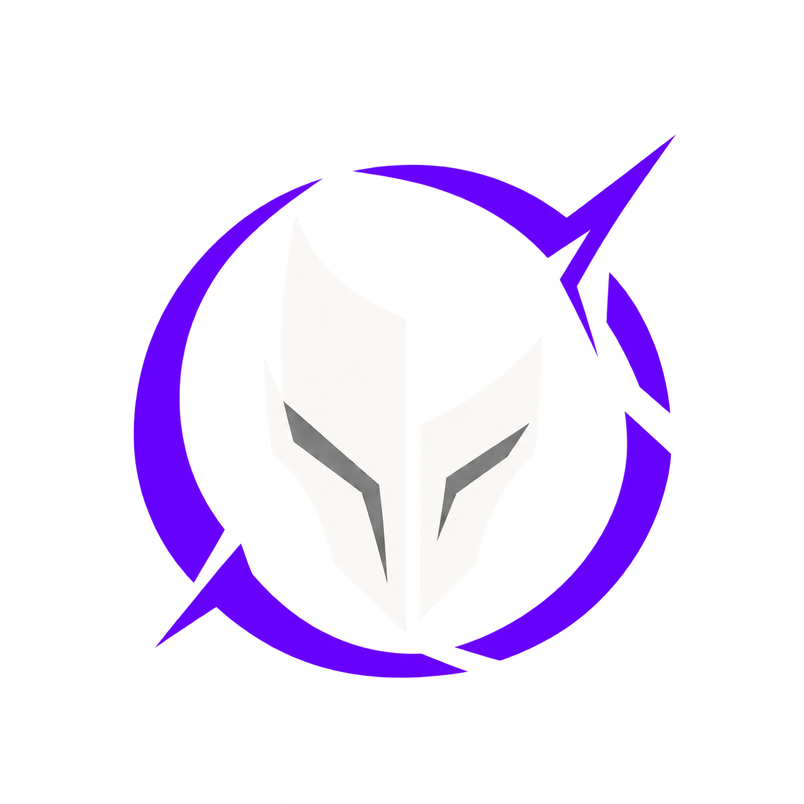
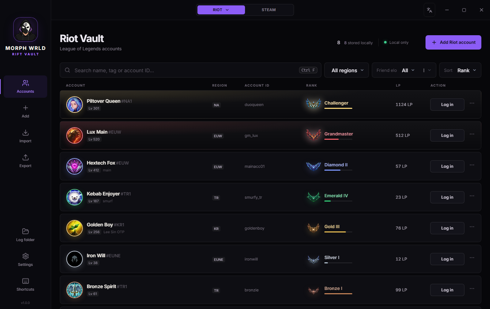
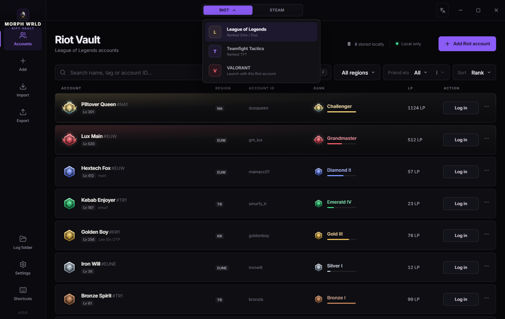
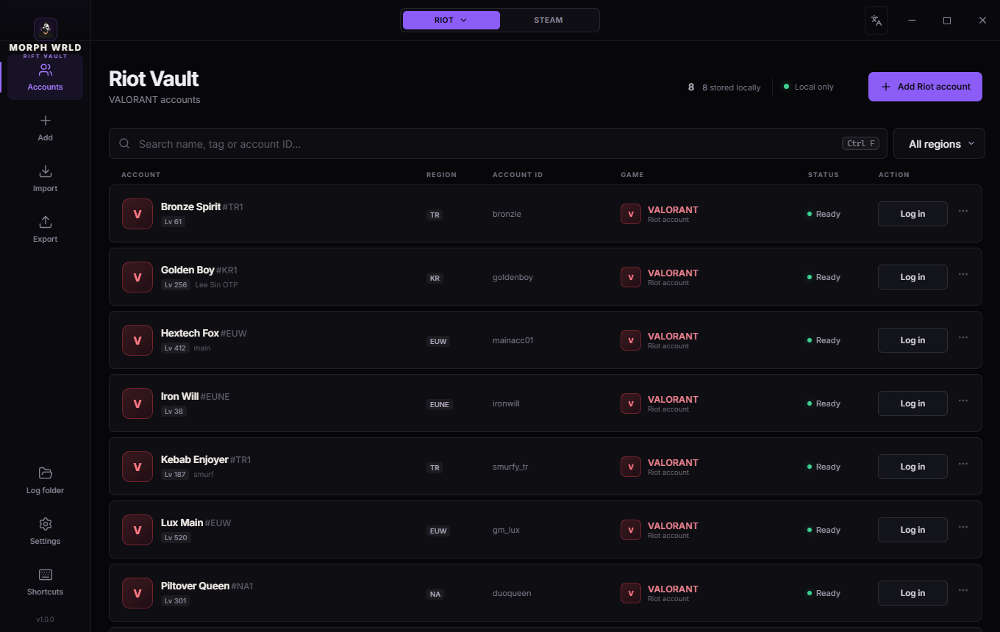
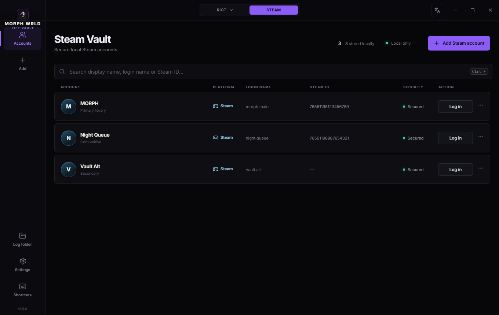
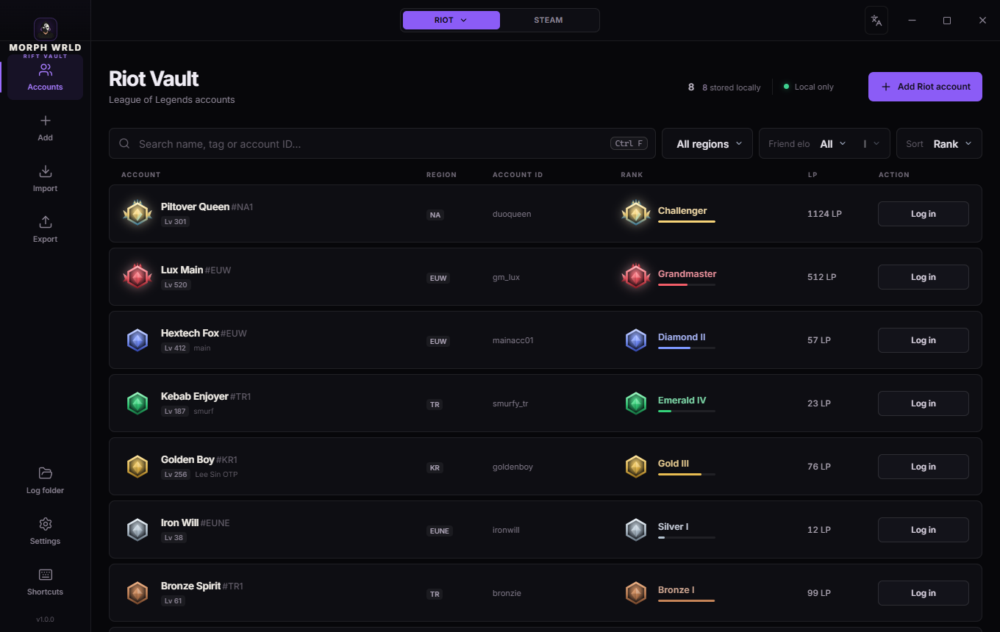
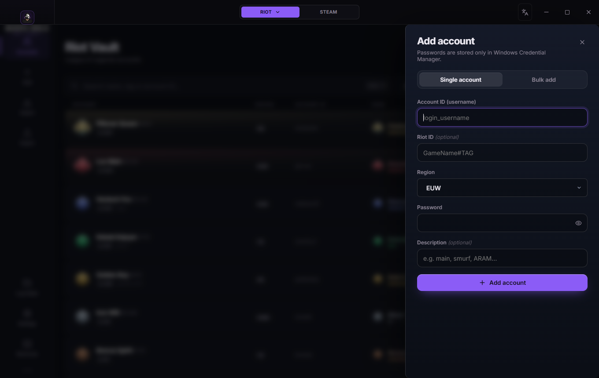
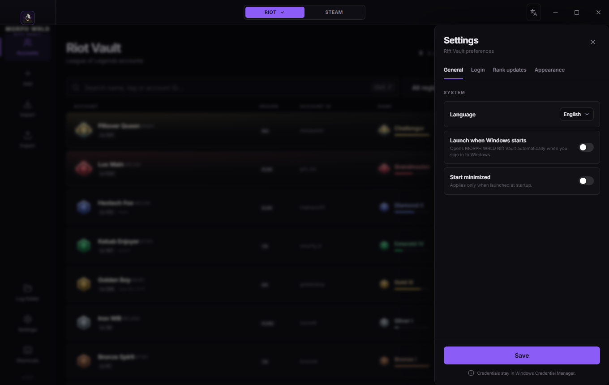
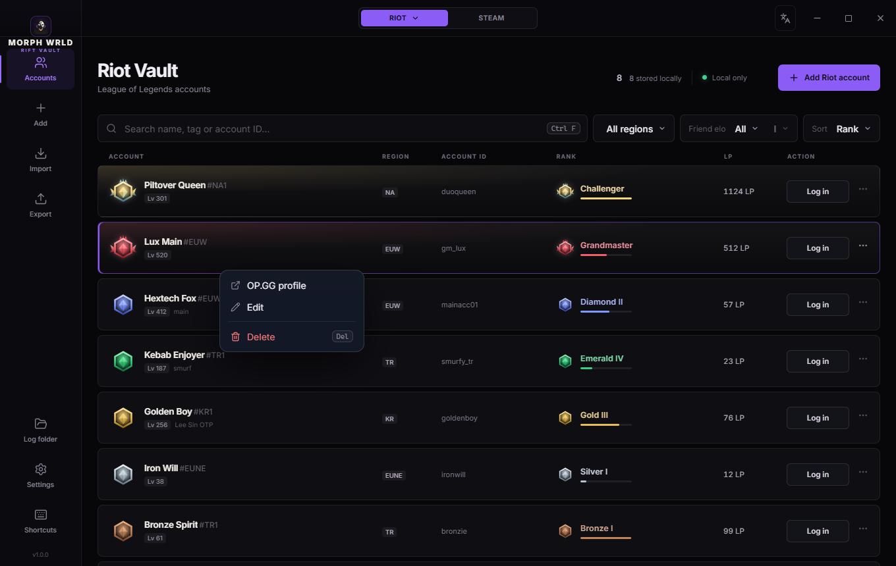

<div align="center">



# MORPH WRLD // RIFT VAULT

**A personal MORPH WRLD account hub for League of Legends, Teamfight Tactics, VALORANT, Steam, Epic Games, and EA app / Origin.**
One-click access, current Riot ranks, separate platform vaults, and passwords kept in Windows Credential Manager.


[](LICENSE)



</div>

> This is an independent MORPH WRLD project for personal account management.
> It is not an official Riot Games, Valve, Epic Games, EA, or OP.GG product.

## Features

- **One-click login.** Press **Log in** and Rift Vault opens the Riot Client, enters your credentials and launches the game: League of Legends, or Teamfight Tactics in TFT mode.
- **LoL and TFT ranks.** Current rank, LP, level and last season's (or last set's) rank are pulled from OP.GG. Switch between modes with one click.
- **Riot game picker.** Choose League of Legends, Teamfight Tactics, or VALORANT from one compact Riot menu; every option uses the same protected Riot account vault.
- **Steam vault.** Store separate Steam accounts, switch the desktop client with one click, and keep Steam Guard in the normal login flow.
- **Other platforms.** Keep separate Epic Games and EA app / Origin accounts, open the matching client, and securely copy credentials when needed.
- **Deliberate platform picker.** Riot, Steam, and Others open a menu first; the active vault changes only after you choose the game or platform.
- **Auto refresh.** Ranks update in the background on your schedule, every 30 minutes by default.
- **Duo finder.** The *Friend elo* filter shows which of your accounts can play ranked with a friend of a given rank.
- **Safe by design.** Passwords live in Windows Credential Manager and never reach the interface. A copied password is wiped from the clipboard after 30 seconds.
- **Made for daily use.** Launch with Windows, start minimized, keyboard shortcuts, import/export, and 6 languages (English, Türkçe, Deutsch, Español, Français, Português).

## Screenshots

<table>
  <tr>
    <td width="50%"><br /><sub><b>Riot chooser:</b> League, TFT, or VALORANT.</sub></td>
    <td width="50%"><br /><sub><b>VALORANT view:</b> launch the selected Riot account into VALORANT.</sub></td>
  </tr>
  <tr>
    <td colspan="2"><br /><sub><b>Steam Vault:</b> locally stored Steam accounts with one-click client switching.</sub></td>
  </tr>
  <tr>
    <td width="50%"><br /><sub><b>Login, step by step:</b> opening the Riot Client, entering credentials, launching the game.</sub></td>
    <td width="50%"><br /><sub><b>List view</b> for many accounts.</sub></td>
  </tr>
  <tr>
    <td><br /><sub><b>Add one account or paste many at once.</b></sub></td>
    <td><br /><sub><b>Settings:</b> startup, refresh interval, login method, updates.</sub></td>
  </tr>
  <tr>
    <td colspan="2"><br /><sub><b>Right-click</b> an account for its profile, editing and deletion.</sub></td>
  </tr>
</table>

## Installation

1. Download and run **`MW - Accounts Hub.exe`** from the latest GitHub Release.
2. You can move the executable anywhere you like, such as `Documents\MORPH WRLD`.
3. On first launch Windows SmartScreen may say *"Windows protected your PC"*, because the app is not code-signed. Click **More info → Run anyway**.

**Requirements:** Windows 10 or 11 with Microsoft Edge WebView2. WebView2 ships with Windows 11 and current Windows 10. If the window stays blank, install the [WebView2 Runtime](https://developer.microsoft.com/microsoft-edge/webview2/).

## Getting started

### Add your accounts

Click **Add account** (or press `Ctrl+N`) and fill in:

| Field | What to enter |
|---|---|
| **Account ID** | The username you type into the Riot Client login screen |
| **Riot ID** | Optional in-game name with tag, e.g. `Hide on bush#KR1` (used to look up ranks on OP.GG) |
| **Region** | The account's server |
| **Password** | Stored only in Windows Credential Manager |

If you don't remember the Riot ID, leave it blank. You can still log in with one click. The card shows **No Riot ID associated** and an **Add Riot ID** action when you want to fetch ranks later.

If a saved Riot ID can no longer be found on OP.GG, the card shows **Riot ID not found on OP.GG** and **Update Riot ID**. Enter the new `GameName#TAG` to fetch ranks again. Login still uses the saved username and password.

To add several accounts at once, open the **Bulk add** tab and paste one account per line:

```text
username1--Player One#EUW--password1
username2--Player Two#TR1--password2
username3----password3
```

Ranks are fetched right after adding. Use **Refresh ranks** (`Ctrl+R`) at any time.

### Log in

Press **Log in** on a card (or `Ctrl+Shift+V` with the account selected). Rift Vault will:

1. Open the Riot Client.
2. Wait until it is fully loaded and showing its login screen.
3. Bring it to the front and enter your username and password.
4. Wait until the Riot Client confirms you are signed in, then launch the game.

A full-screen progress view shows each step, and you can cancel at any time. For safety:

- Credentials are only typed after the Riot Client reports that nobody is signed in and its login window is in front. If something doesn't look right, the login stops instead of typing elsewhere.
- If another account is signed in, you are asked before it is signed out.
- If a League or TFT client is open with another account, Rift Vault warns you before closing it. If a **match is in progress**, the warning says so: leaving a game can lead to penalties.
- If you need to finish signing in yourself (2FA code, captcha), the game launches only after a confirmed sign-in.

Prefer the old behavior? In **Settings → Login**, choose *Type into the previous window*: the app switches back to the last window with Alt+Tab and types there.

### Riot games

Click **Riot** at the top and choose **League of Legends**, **Teamfight Tactics**, or **VALORANT**. League and TFT display their respective rank data. VALORANT uses the same Riot account credentials and asks the local Riot Client to launch the installed `valorant.live` product after sign-in.

### Steam accounts

Choose **Steam** at the top, then click **Add Steam account**. The login name and password are required; display name, Steam ID, and description are optional. Passwords are stored under a separate Windows Credential Manager service and are not written to `steam_accounts.json`.

Press **Log in** to close the current Steam session and restart Steam with the selected account. Steam Guard can still request mobile or email approval. Steam's supported `-login` launch option briefly supplies the credentials to the Steam process, so use this only on your trusted personal Windows account—not on a shared PC.

### Epic Games and EA app / Origin

Click **Others** and choose **Epic Games** or **EA app / Origin**. Each platform keeps its own account list. The hub can open the installed launcher and copy the selected login or password; the launcher remains responsible for sign-in, two-factor authentication, and captchas.

### Rank updates

- Cards show the latest rank and LP to help you choose an account. Refreshing replaces that rank data; the app does not collect LP progression.
- The **Auto refresh** button in the sidebar shows when the next refresh happens. Click it to refresh immediately. Change the interval (5 minutes to 24 hours) in **Settings → Rank updates**.
- Rank data comes from public OP.GG profile pages, two requests per account (LoL and TFT). Very short intervals with many accounts may get rate-limited.

## Settings

| Setting | Description |
|---|---|
| Language | English, Türkçe, Deutsch, Español, Français (follows your system language by default) |
| Launch when Windows starts | Opens MORPH WRLD Rift Vault when you sign in to Windows; optionally **start minimized** |
| Refresh ranks automatically | On/off and interval in minutes (default 30) |
| Login method | *Open the Riot Client and sign in* (default) or *Type into the previous window* |
| Launch the game after signing in | Starts the selected League, TFT, or VALORANT product once sign-in is confirmed |

## Keyboard shortcuts

| Shortcut | Action |
|---|---|
| `Ctrl+Shift+V` | Log in with the selected account |
| `Ctrl+C` | Copy the account ID (press again for the password) |
| `↑ ↓ ← →` | Move between accounts |
| `Delete` | Delete the selected account (asks first) |
| `Ctrl+F` | Search |
| `Ctrl+N` | Add account |
| `Ctrl+R` / `F5` | Refresh ranks |
| `Ctrl+1` … `Ctrl+6` | League / TFT / VALORANT / Steam / Epic Games / EA app |
| `Ctrl+,` | Settings |
| Double-click | Edit an account |
| Right-click | All actions |

## Privacy and security

- **Passwords** are stored in **Windows Credential Manager** (separate services for Riot, Steam, and other launchers). They are never written to the app's data files and never sent to the interface. Copying and login happen in the native backend.
- **Clipboard:** copied passwords are cleared after 30 seconds, and the clipboard is cleared after every automatic login.
- **Exports** (`Export`) contain passwords in **plain text**. The app warns you before exporting; keep such files private.
- **Network:** the app contacts OP.GG for public Riot rank data and the Riot Client's local API for sign-in state. Steam login is handed directly to the installed Steam desktop client. There is no telemetry and no MORPH WRLD account server.
- **Local data** is stored in `%APPDATA%\MORPH-WRLD-Rift-Vault\`:

  | File | Contents |
  |---|---|
  | `rift_vault_accounts.json` | Accounts and ranks (no passwords) |
  | `steam_accounts.json` | Steam account labels and IDs (no passwords) |
  | `other_accounts.json` | Epic Games and EA account labels (no passwords) |
  | `settings.json` | Your settings |
  | `logs\` | Diagnostic logs containing only fixed event codes, never account data |

## Troubleshooting

| Problem | What to do |
|---|---|
| *Riot Client was not found* | Install the Riot Client, or switch **Settings → Login** to *Type into the previous window*. |
| *The Riot Client login screen didn't appear in time* | Open the Riot Client once manually (it may be updating), then try again. |
| Ranks show **Unavailable** | Check that the Riot ID (`Name#TAG`) and region are correct, then use **Refresh ranks**. OP.GG may also be rate-limiting; try again later. |
| Something else | Open **Log folder** in the sidebar and inspect the newest `.log` file. Logs contain no account data. |

## Building from source

Requirements: [Rust](https://rustup.rs) (MSVC toolchain), [Node.js](https://nodejs.org) 20+, and the Visual Studio C++ Build Tools.

```bash
npm install
npx tauri dev              # run with hot reload
npx tauri build --no-bundle  # build target/release/MorphWrldRiftVault.exe
```

`npm run dev` opens the interface in a browser with demo data (no backend). `npm run screenshots` regenerates the images in `docs/screenshots` from that demo data (requires Chrome and ffmpeg).

| Folder | Contents |
|---|---|
| `src/` | Rust core: storage, Credential Manager, OP.GG parsing, Riot Client integration, auto-type |
| `src-tauri/` | Tauri shell: commands, auto refresh scheduler, and settings |
| `ui/` | Web interface (TypeScript + CSS); translations live in `ui/src/i18n.ts` |

## License and disclaimer

MORPH WRLD Rift Vault is released under the [MIT License](LICENSE).

MORPH WRLD Rift Vault isn't endorsed by Riot Games and doesn't reflect the views or opinions of Riot Games or anyone officially involved in producing or managing Riot Games properties. Riot Games, League of Legends, Teamfight Tactics, and VALORANT are trademarks or registered trademarks of Riot Games, Inc. Rank data is provided by OP.GG; this project is not affiliated with OP.GG.

Steam is a trademark of Valve Corporation. This project is not affiliated with or endorsed by Valve.

Sharing accounts may be against Riot Games' Terms of Service. You are responsible for how you use this tool.
